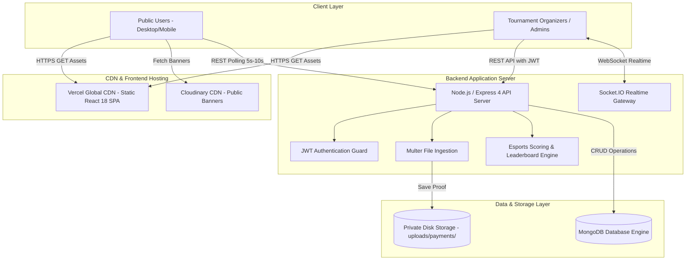
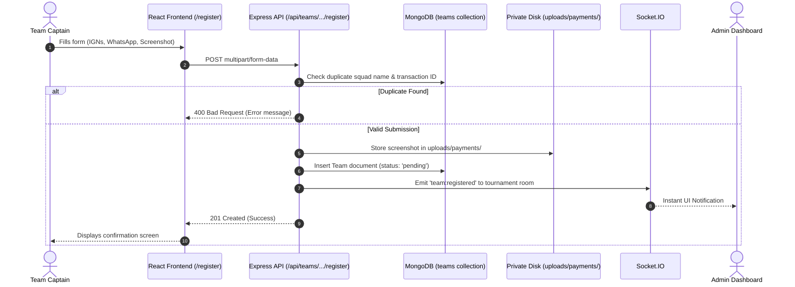
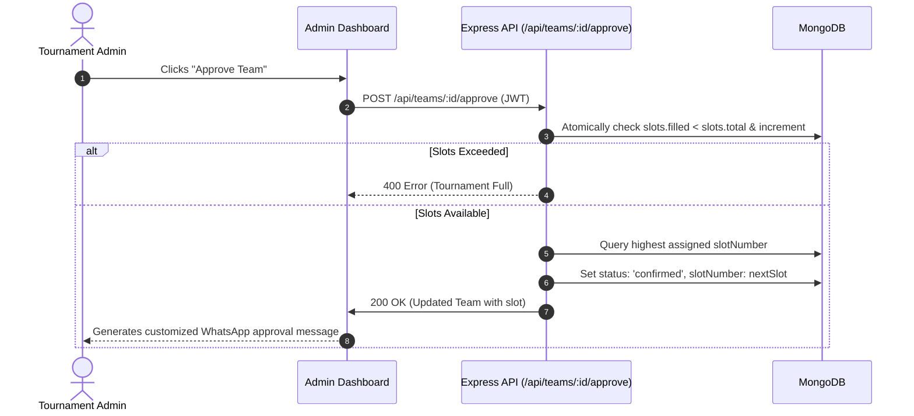
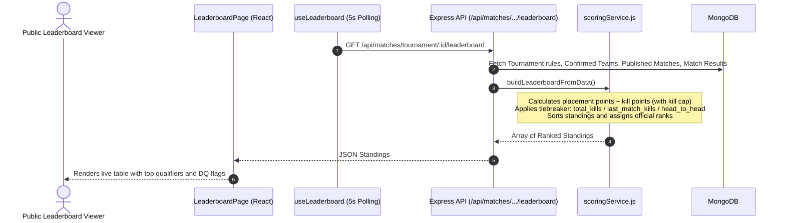

# 🏗️ NSK-ESPORTS — System Architecture Documentation

This document describes the migrated production architecture for **NSK-ESPORTS**, transitioning from Supabase/PostgreSQL to a decoupled **React 18 + Node.js/Express + MongoDB** stack.

---

## 1. High-Level Production Architecture

---

## 2. Team Registration Flow

---

## 3. Race-Safe Admin Approval Flow

---

## 4. Live Leaderboard & Scoring Engine Flow

---

## 5. Security Architecture

1. **Defense in Depth**: Frontend route protections (`ProtectedRoute.jsx`) serve exclusively for UX; security is guaranteed by server-side middleware (`protectAdmin`).
2. **Private Payment Protection**: Uploaded payment receipts are stored outside public document roots. Access is gated by `GET /api/teams/:id/screenshot`, which requires an authenticated Admin JWT.
3. **Password Security**: Admin credentials use salted bcrypt hashes (work factor 10). Passwords are never stored in plaintext.
4. **Injection Protection**: All queries use Mongoose schemas with strict sanitization and parameterized conditions.
