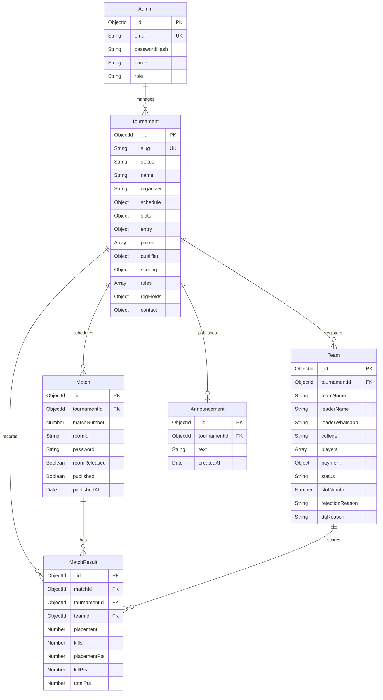

# 🗄️ NSK-ESPORTS — MongoDB Database Documentation

This document provides complete technical specifications for the MongoDB database architecture powering **NSK-ESPORTS**, replacing the legacy PostgreSQL/Supabase database.

---

## 1. Database Architecture Overview

- **Database Engine:** MongoDB 6+
- **Object Modeling:** Mongoose 8.x
- **Connection URI:** `mongodb://127.0.0.1:27017/nsk_esports` (Local) / MongoDB Atlas URI (Production)
- **Design Strategy:** Hybrid approach — relational referencing via `ObjectId` for core entities (`Tournament`, `Team`, `Match`, `MatchResult`, `Announcement`), combined with embedded document arrays for tightly-coupled sub-entities (`players`, `schedule`, `slots`, `scoring`, `prizes`).

---

## 2. Entity-Relationship Model



---

## 3. Collections & Schema Specifications

### 3.1 `tournaments`
Stores all tournament metadata, scoring configurations, rules, schedules, and prize pools.

| Field | Type | Required | Default | Description / Validation |
|---|---|---|---|---|
| `_id` | `ObjectId` | Auto | `ObjectId()` | Unique primary key |
| `slug` | `String` | Yes | — | Unique URL slug (`index: true`) |
| `status` | `String` | Yes | `'draft'` | Enum: `['draft', 'registration_open', 'registration_closed', 'ongoing', 'completed', 'archived']` |
| `name` | `String` | Yes | — | Tournament title |
| `organizer` | `String` | Yes | — | Host or organization name |
| `tagline` | `String` | No | `''` | Event subtitle |
| `bannerUrl` | `String` | No | `''` | Cloudinary public CDN banner URL |
| `game` | `String` | No | `'Free Fire Max'` | Game title |
| `teamFormat` | `String` | No | `'Squad (4 Players)'` | Team size format |
| `schedule.date` | `Date` | No | `null` | Tournament start date |
| `schedule.regDeadline` | `Date` | No | `null` | Cutoff timestamp for registrations |
| `schedule.roomReleaseTime` | `String` | No | `''` | String time for credentials broadcast |
| `schedule.matchStartTime` | `String` | No | `''` | String time for match kickoff |
| `schedule.numMatches` | `Number` | Yes | `6` | Integer between 1 and 10 |
| `slots.total` | `Number` | Yes | `12` | Max squad capacity (min 1) |
| `slots.filled` | `Number` | Yes | `0` | Confirmed squad count (atomically updated) |
| `entry.fee` | `Number` | Yes | `0` | Fee in INR (0 = Free) |
| `entry.upiId` | `String` | No | `''` | Organizer UPI ID for collection |
| `entry.qrCodeUrl` | `String` | No | `''` | UPI QR Code image URL |
| `prizes` | `Array<Object>` | No | `[]` | Embedded array: `[{ position, amount, label }]` |
| `qualifier.enabled` | `Boolean` | Yes | `false` | Qualifier stage toggle |
| `qualifier.topN` | `Number` | No | `4` | Number of teams qualifying for next stage |
| `qualifier.roundName` | `String` | No | `'Inter-College Round'` | Next stage name |
| `scoring.preset` | `String` | Yes | `'pict'` | Enum: `['pict', 'eagle', 'custom']` |
| `scoring.placementPoints` | `Map<Number>` | Yes | `{}` | Map of position ➔ points |
| `scoring.killPointValue` | `Number` | Yes | `1.0` | Multiplier per kill |
| `scoring.killCap` | `Number` | No | `0` | Max kills awarded (0 = uncapped) |
| `scoring.tiebreaker` | `String` | Yes | `'total_kills'` | Enum: `['total_kills', 'last_match_kills', 'head_to_head']` |
| `rules` | `Array<String>` | No | `[]` | List of tournament rules |
| `regFields.college` | `Boolean` | Yes | `false` | Enable college field in registration form |
| `regFields.transactionId` | `Boolean` | Yes | `true` | Enable transaction ID in registration form |
| `regFields.paymentScreenshot` | `Boolean` | Yes | `true` | Enable screenshot upload in registration form |
| `contact.whatsapp` | `String` | No | `''` | Organizer contact phone |
| `contact.whatsappGroup` | `String` | No | `''` | WhatsApp group invite URL |
| `contact.discord` | `String` | No | `''` | Discord invite URL |
| `contact.instagram` | `String` | No | `''` | Instagram handle |
| `legacyId` | `String` | No | — | Supabase PostgreSQL UUID mapping |
| `timestamps` | `Date` | Auto | `now()` | Managed via `createdAt` and `updatedAt` |

**Indexes:**
- `slug: 1` (`unique: true`)
- `{ status: 1, createdAt: -1 }` (compound index for high-speed public tournament listing)

---

### 3.2 `teams`
Stores squad information, player lineups, assigned slot numbers, and payment references.

| Field | Type | Required | Default | Description / Validation |
|---|---|---|---|---|
| `_id` | `ObjectId` | Auto | `ObjectId()` | Unique team ID |
| `tournamentId` | `ObjectId` | Yes | — | Ref: `Tournament` (`index: true`) |
| `teamName` | `String` | Yes | — | Squad name |
| `leaderName` | `String` | Yes | — | Team captain name |
| `leaderWhatsapp` | `String` | Yes | — | Leader phone number (`index: true`) |
| `college` | `String` | No | `''` | College / Department name |
| `players` | `Array<Object>` | Yes | `[]` | Embedded array of players: `[{ ign, uid, role }]` |
| `payment.transactionId` | `String` | No | `null` | UPI / Bank transaction reference |
| `payment.screenshotPath` | `String` | No | `null` | Filename on private server disk (`uploads/payments/`) |
| `status` | `String` | Yes | `'pending'` | Enum: `['pending', 'confirmed', 'rejected', 'disqualified']` |
| `slotNumber` | `Number` | No | `null` | Assigned lobby slot (1 to N) |
| `rejectionReason` | `String` | No | `null` | Admin reason for rejection |
| `dqReason` | `String` | No | `null` | Admin reason for disqualification |
| `legacyId` | `String` | No | — | Supabase PostgreSQL UUID mapping |

**Indexes:**
- `{ tournamentId: 1, slotNumber: 1 }` (`unique: true`, partial filter: `{ slotNumber: { $type: "number" } }`) — Prevents duplicate slot collisions.
- `{ tournamentId: 1, status: 1 }` (Optimizes confirmed teams lookups for leaderboard).
- `{ tournamentId: 1, teamName: 1 }` (Duplicate squad name prevention).

---

### 3.3 `matches`
Stores room ID and passwords for each map.

| Field | Type | Required | Default | Description / Validation |
|---|---|---|---|---|
| `_id` | `ObjectId` | Auto | `ObjectId()` | Unique match ID |
| `tournamentId` | `ObjectId` | Yes | — | Ref: `Tournament` (`index: true`) |
| `matchNumber` | `Number` | Yes | — | Map number (1 to 10) |
| `roomId` | `String` | No | `''` | Free Fire Room ID |
| `password` | `String` | No | `''` | Free Fire Room Password |
| `roomReleased` | `Boolean` | Yes | `false` | Controls visibility in Team Portal |
| `published` | `Boolean` | Yes | `false` | Controls visibility in Live Leaderboard |
| `publishedAt` | `Date` | No | `null` | Timestamp when scores were made public |

**Indexes:**
- `{ tournamentId: 1, matchNumber: 1 }` (`unique: true`) — Guarantees unique match numbers per tournament.

---

### 3.4 `matchresults`
Stores team performance for every individual match.

| Field | Type | Required | Default | Description / Validation |
|---|---|---|---|---|
| `_id` | `ObjectId` | Auto | `ObjectId()` | Unique result ID |
| `matchId` | `ObjectId` | Yes | — | Ref: `Match` (`index: true`) |
| `tournamentId` | `ObjectId` | Yes | — | Ref: `Tournament` (`index: true`) |
| `teamId` | `ObjectId` | Yes | — | Ref: `Team` (`index: true`) |
| `placement` | `Number` | Yes | — | Match finish rank (1-12) |
| `kills` | `Number` | Yes | `0` | Team total kills secured |
| `placementPts` | `Number` | Yes | `0` | Calculated placement points |
| `killPts` | `Number` | Yes | `0` | Calculated kill points |
| `totalPts` | `Number` | Yes | `0` | Sum of placement + kill points |

**Indexes:**
- `{ matchId: 1, teamId: 1 }` (`unique: true`) — Ensures a team has exactly one score entry per map.
- `{ tournamentId: 1, teamId: 1 }` — Fast lookup for cumulative score aggregations.

---

### 3.5 `announcements`
Stores admin broadcasts.

| Field | Type | Required | Default | Description / Validation |
|---|---|---|---|---|
| `_id` | `ObjectId` | Auto | `ObjectId()` | Unique ID |
| `tournamentId` | `ObjectId` | Yes | — | Ref: `Tournament` (`index: true`) |
| `text` | `String` | Yes | — | Announcement message |
| `createdAt` | `Date` | Auto | `now()` | Broadcast timestamp |

**Indexes:**
- `{ tournamentId: 1, createdAt: -1 }`

---

### 3.6 `admins`
Stores administrator accounts with salted bcrypt password hashes.

| Field | Type | Required | Default | Description / Validation |
|---|---|---|---|---|
| `_id` | `ObjectId` | Auto | `ObjectId()` | Unique ID |
| `email` | `String` | Yes | — | Unique, lowercase email (`index: true`) |
| `password` | `String` | Yes | — | Bcrypt hash (salt factor 10) |
| `name` | `String` | No | `'Tournament Admin'` | Display name |
| `role` | `String` | Yes | `'admin'` | Role identifier |

---

## 4. Race-Safe Atomic Slot Assignment

In PostgreSQL, an RPC procedure incremented slots. In MongoDB, atomic updates prevent concurrent slot conflicts:

```javascript
// 1. Atomically verify capacity and increment filled slots
const tournament = await Tournament.findOneAndUpdate(
  { _id: tournamentId, "slots.filled": { $lt: "$slots.total" } },
  { $inc: { "slots.filled": 1 } },
  { new: true }
);
if (!tournament) throw new Error("Tournament slots are full");

// 2. Query highest assigned slot number
const lastSlot = await Team.findOne({ tournamentId, slotNumber: { $ne: null } })
  .sort({ slotNumber: -1 });
const nextSlot = (lastSlot?.slotNumber || 0) + 1;

// 3. Update team to confirmed with assigned slotNumber
const confirmedTeam = await Team.findByIdAndUpdate(
  teamId,
  { status: 'confirmed', slotNumber: nextSlot, rejectionReason: null },
  { new: true }
);
```
