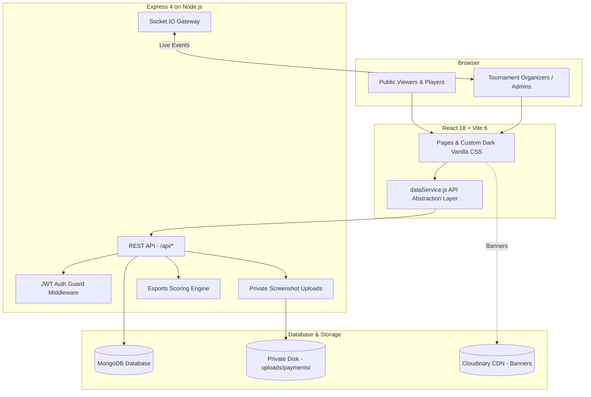

# 🎮 NSK ESPORTS — Free Fire Max Tournament Platform (MERN Stack)

A production-ready, full-stack tournament management platform for Free Fire Max esports. Built for college organizers to host tournaments, handle team squad registrations with payment verification, enter live match placements and kills, and broadcast real-time public leaderboards.

> **Architecture Update:** Migrated from Supabase/PostgreSQL to a decoupled **Node.js + Express + MongoDB** backend with JWT authentication and Socket.IO realtime capabilities, maintaining 100% of the original UI design, scoring engines, and public/admin workflows.

---

## 📋 Table of Contents

- [Features](#-features)
- [Tech Stack](#-tech-stack)
- [Architecture](#-architecture)
- [Project Structure](#-project-structure)
- [Getting Started (Local Setup)](#-getting-started-local-setup)
- [Database Schema (MongoDB)](#-database-schema-mongodb)
- [API Reference](#-api-reference)
- [Authentication & Security](#-authentication--security)
- [Testing & Validation](#-testing--validation)
- [Deployment Guide](#-deployment-guide)
- [Documentation Directory](#-documentation-directory)

---

## ✨ Features

### Public Features
| Feature | Description |
|---|---|
| **Tournament Listing** | Browse active tournaments with real-time slot counters & status tags |
| **Tournament Detail** | Hero section, countdown timer, prize pool distribution, schedule |
| **Team Registration** | Squad registration (4 players + sub) with duplicate IGN/UID protection & payment receipt upload |
| **Live Leaderboard** | Auto-polling every 5 seconds with per-match breakdown (kills, placement, total) |
| **Screenshot Mode** | Clean export view optimized for PNG download via `html2canvas` |
| **WhatsApp Sharing** | Pre-formatted WhatsApp standings generator |
| **Qualifier Badges** | Dynamic top N squad qualification badges (`⭐ QUALIFIED`) |
| **DQ Handling** | Disqualified squads styled and pinned to bottom with recorded reason |
| **Team Portal** | Instant login with team name + captain phone to view room credentials & stats |

### Admin Features
| Feature | Description |
|---|---|
| **Secure Admin Portal** | Email & password login protected with JWT tokens and bcrypt hashing |
| **8-Step Tournament Wizard** | Create events with custom scoring presets (PICT, Eagle, Custom), prize pools, rules, and form toggles |
| **Status Management** | State lifecycle: `Draft` ➔ `Registration Open` ➔ `Ongoing` ➔ `Completed` ➔ `Archived` |
| **Team Management** | Approve squads with race-safe atomic slot assignment, or reject/disqualify with recorded reasons |
| **Payment Verification** | Stream private payment screenshots securely without public exposure |
| **Automated WhatsApp Messages** | One-click copy for squad approval, room ID release, and result announcements |
| **Match Results Entry** | Per-team placement and kills entry with live preview calculation |
| **Announcements** | Real-time broadcast messages pushed via WebSockets to all viewer pages |

---

## 🛠 Tech Stack

| Layer | Technology | Purpose |
|---|---|---|
| **Frontend** | React 18 + Vite 6 | High-performance SPA with client-side routing |
| **Routing** | React Router v6 | Page and admin dashboard navigation |
| **Styling** | Vanilla CSS | Custom dark gaming-themed design system |
| **Backend** | Node.js + Express 4 | REST API, validation, error handling, rate limiting |
| **Database** | MongoDB 6+ / Mongoose 8 | Document database with atomic operations and indexing |
| **Realtime** | Socket.IO | Push updates for team registrations and announcements |
| **Auth** | JWT + Bcrypt | Server-side stateless authentication for admin routes |
| **File Storage** | Multer (Local/Private) + Cloudinary | Private payment receipts & public banners |
| **Sanitization** | DOMPurify | Cross-site scripting (XSS) input filtering |

---

## 🏗 Architecture



---

## 📁 Project Structure

```text
NSK-ESPORTS/
├── .env.example                     # Environment template
├── .env                             # Local environment variables
├── package.json                     # Unified scripts & dependencies
├── vite.config.js                   # Vite config with /api reverse proxy
├── vercel.json                      # Vercel deployment configuration
│
├── server/                          # Express + MongoDB Backend
│   ├── config/
│   │   └── db.js                    # MongoDB connection helper
│   ├── models/                      # Mongoose Schema Definitions
│   │   ├── Admin.js                 # Admin authentication model
│   │   ├── Tournament.js            # Tournament schema & settings
│   │   ├── Team.js                  # Team & player lineup schema
│   │   ├── Match.js                 # Match & room credentials schema
│   │   ├── MatchResult.js           # Per-match score record schema
│   │   └── Announcement.js          # Broadcast announcements
│   ├── middleware/
│   │   ├── auth.js                  # JWT admin verification middleware
│   │   ├── errorHandler.js          # Centralized error handler
│   │   └── upload.js                # Secure private Multer upload handler
│   ├── controllers/
│   │   ├── authController.js
│   │   ├── tournamentController.js
│   │   ├── teamController.js
│   │   ├── matchController.js
│   │   └── announcementController.js
│   ├── routes/
│   │   ├── authRoutes.js
│   │   ├── tournamentRoutes.js
│   │   ├── teamRoutes.js
│   │   ├── matchRoutes.js
│   │   └── announcementRoutes.js
│   ├── services/
│   │   └── scoringService.js        # Esports scoring & tiebreaker engine
│   ├── scripts/
│   │   ├── seed-demo-data.js        # Demo tournament and teams seeder
│   │   ├── test-backend.js          # Unit & model integration test suite
│   │   ├── test-e2e-api.js          # Complete 10-step REST API test suite
│   │   └── migrate-from-supabase.js # Supabase to MongoDB data migrator
│   ├── app.js                       # Express app configuration
│   └── server.js                    # Server startup & Socket.IO initialization
│
├── uploads/
│   └── payments/                    # Private disk storage for payment receipts
│
└── src/                             # React Frontend
    ├── main.jsx                     # Application entry point
    ├── App.jsx                      # Route definitions
    ├── index.css                    # Design system (Do not modify)
    ├── contexts/
    │   ├── AuthContext.jsx          # JWT session provider
    │   └── ToastContext.jsx         # Toast notification provider
    ├── services/
    │   └── dataService.js           # REST API client matching original contracts
    ├── pages/                       # Route components
    │   ├── HomePage.jsx
    │   ├── RegistrationPage.jsx
    │   ├── LeaderboardPage.jsx
    │   ├── RulesPage.jsx
    │   ├── TeamPortalPage.jsx
    │   └── AdminPage.jsx
    └── components/                  # UI & admin wizard components
```

---

## 🚀 Getting Started (Local Setup)

### 1. Prerequisites
- **Node.js**: v18+ (Tested on v23)
- **MongoDB**: Installed locally or a free MongoDB Atlas connection URI

### 2. Install Dependencies
```bash
npm install
```

### 3. Environment Configuration
Create `.env` by copying `.env.example`:
```bash
cp .env.example .env
```
Ensure your MongoDB URI and initial Admin credentials are set:
```env
PORT=5000
MONGODB_URI=mongodb://127.0.0.1:27017/nsk_esports
JWT_SECRET=super_secret_jwt_key_2026
ADMIN_EMAIL=admin@nsk-esports.in
ADMIN_PASSWORD=Admin@12345
CLIENT_URL=http://localhost:5173
```

### 4. Seed Demo Tournament Data
Populate MongoDB with realistic tournament data, confirmed teams, matches, and published scores:
```bash
npm run seed
```

### 5. Run Both Backend & Frontend
Launch both the Express API and Vite dev server simultaneously:
```bash
npm run dev:all
```
- **Frontend:** `http://localhost:5173`
- **Backend API:** `http://localhost:5000/api`
- **Admin Login:** Navigate to `http://localhost:5173/admin` and log in with your configured admin email and password.

---

## 🧪 Testing & Validation

Run the automated test suites to verify backend integrity, scoring calculations, and REST endpoints:

```bash
# Test Mongoose models, password hashing, atomic slots, and scoring calculations
npm run test:backend

# Test all 10 REST API endpoints end-to-end
npm run test:e2e
```

---

## 📚 Documentation Directory

Detailed technical documents are available in the repository root:
- [DATABASE.md](DATABASE.md) — Comprehensive MongoDB collection schemas, field data types, compound indexes, and atomic slot assignment logic.
- [API.md](API.md) — Exhaustive REST API endpoint reference with request/response payloads.
- [ARCHITECTURE.md](ARCHITECTURE.md) — Architectural workflows, registration sequence diagrams, and security specifications.
- [MIGRATION.md](MIGRATION.md) — Detailed mapping of legacy PostgreSQL tables to MongoDB and rollback strategy.
- [DEPLOYMENT.md](DEPLOYMENT.md) — Step-by-step production deployment instructions for MongoDB Atlas, Render/Railway, and Vercel.

---

## 📜 License

MIT License — Free to use, modify, and distribute.
